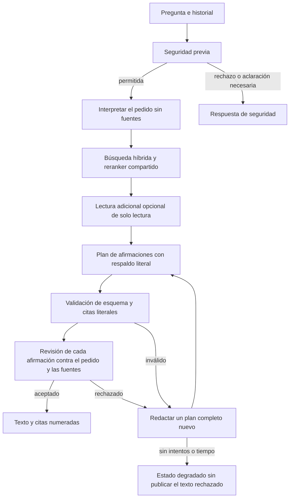

# Flujo de información de Gianna

Estado local: 8 de noviembre de 2026. Los resultados, incluidos los intentos rechazados, se conservan en [VALIDACION](../reports/VALIDACION.md). Este documento describe el código actual; no acredita un despliegue en producción.

Gianna responde el pedido literal con información pertinente, de igual a igual. Una descripción de un negocio aporta contexto y no solicita por sí sola una evaluación comercial, recomendaciones, una lista de verificaciones ni una entrevista. Los procedimientos, restricciones y criterios comparativos se explican cuando se solicitan, conservando las condiciones que cambian los datos.

## Flujo actual

1. `Agent.assess` mantiene las compuertas existentes y la revisión semántica de `risk.py` antes de buscar conocimiento. Un fallo del evaluador no habilita búsquedas ni una respuesta empresarial degradada. Los saludos se contestan brevemente, después de esta evaluación.
2. `information.py` solicita `interpretar_pedido` exclusivamente con la pregunta y el historial. No recibe fuentes ni el mapa de títulos. Fija las dimensiones solicitadas y una consulta de búsqueda; las abreviaturas se interpretan en el ámbito de Lavalleja, Uruguay. Las respuestas anteriores no crean hechos ni preferencias.
3. La recuperación conserva Granite, BM25 y mMARCO. Un solo `RerankBudget` acompaña la búsqueda inicial y las búsquedas adicionales; su plazo comienza antes del encoder. Se conservan seis candidatos, 160 tokens y hasta 1.500 ms, caché y fallback híbrido. No se eliminó el reranker ni se cambió su perfil.
4. Se admite una ronda adicional de investigación con hasta seis llamadas a `buscar_en_la_guia` o `ver_ficha`. El mapa público sirve para descubrir fuentes; nunca constituye evidencia. Las consultas precisas abren el contenido documental de las fichas recuperadas; la metodología comercial íntegra solo se abre si el pedido previo la solicita. Las consultas generales usan las vistas informativas.
5. `redactar_informacion` produce hasta doce afirmaciones breves, organizadas en párrafos. Cada afirmación indica qué parte del pedido responde y sus fuentes con fragmentos literales contiguos. Los datos, propuestas e interpretaciones se distinguen. El contenido no procede de plantillas por localidad, rubro ni palabras clave.
6. El servidor valida estructura estricta, referencias a fuentes efectivamente expuestas y citas literales. Solo normaliza espacios para comprobar estas citas; no acepta cifras aproximadas, citas inventadas ni fragmentos reconstruidos. Una ausencia puntual no puede sustituir una descripción, posibilidades o comparación.
7. `comprobar_afirmaciones` recibe la pregunta literal, historial, pedido fijado, afirmaciones y fuentes utilizadas. Clasifica la función de cada afirmación y comprueba respaldo, pertinencia, rol informativo y condiciones materiales. Una reserva no solicitada, asesoría o tema ajeno rechaza el plan completo. Un dato ausente directamente preguntado y una condición necesaria son funciones legítimas.
8. Se permiten hasta tres planes, cada uno sujeto a la misma revisión. El control devuelve criterios y ubicaciones de error; se solicita una nueva redacción completa. No se borran oraciones con regex ni se publica una parte del plan rechazado. Solo un plan aceptado se convierte en texto y citas renumeradas.

## Límites y persistencia

- Presupuesto total de 100 segundos, incluido el control de seguridad; cada llamada usa el tiempo restante. La compatibilidad del parámetro `think` comparte el plazo original y no abre otro timeout completo. Gunicorn conserva su límite de 120 segundos.
- Evidencia acotada a 36.000 caracteres. Una ficha que no cabe no se promueve a evidencia del redactor ni de la revisión. Los números de cita son locales a cada respuesta.
- Las lecturas usan la versión pública inmutable seleccionada y sus filtros de audiencia. No hay herramientas de escritura, publicación, web ni acceso a secretos.
- Los logs guardan códigos, índices, conteos y tiempos; no preguntas, planes, citas literales, documentos ni cuerpos del proveedor. Los artefactos de evaluación privada sí conservan entradas y salidas públicas para revisión y permanecen fuera de Git.
- Si el proveedor falla o se agota la revisión, se informa el estado degradado con títulos de las fichas expuestas. No se entrega el texto rechazado ni se afirma que falta conocimiento sobre el tema.
- El historial existente se conserva y llega a interpretación y redacción. Una corrección del usuario estrecha el pedido; no se hereda la asesoría anterior como una instrucción.

## Modelo evaluado y configuración

La candidata seleccionada para este flujo es `mistral-large-4`, consultada en el catálogo real de Ollama Cloud y probada con generación y seguridad reales. DeepSeek continuó produciendo contenido fuera del alcance en las comparaciones conservadas. Gemma respondió más rápido en una tanda, pero introdujo un error factual y omitió condiciones normativas; no se seleccionó por sus tiempos.

El modelo sigue siendo configurable; no hay selección por tema en código. Se actualizó únicamente `OLLAMA_MODEL` en el `.env` local. Si una instalación ya tiene un modelo guardado en **Personalización**, ese ajuste prevalece y debe seleccionarse allí `mistral-large-4`. No se sobrescriben personalizaciones SQL ni se modifica un despliegue remoto automáticamente. No hay alternativa automática por defecto que vuelva silenciosamente a un modelo descartado. Si se configura una alternativa explícita, también se le exige el contrato; eso no certifica su calidad semántica.

Se usan herramientas nativas y validación del servidor: [Ollama documenta que Cloud no admite structured outputs mediante format](https://docs.ollama.com/capabilities/structured-outputs); la [API de herramientas](https://docs.ollama.com/capabilities/tool-calling) proporciona el protocolo utilizado. Las herramientas de respuesta no escriben datos.

## Conocimiento corregido

La entrega vigente es `better-rag/consolidated/Invest_Lavalleja_2026_informativa_ampliada_r2.gianna.json`. Conserva 244 registros públicos y 332 internos, con 192 fuentes. El compilador mantiene los originales, exige hashes para aplicar enmiendas y no publica la base.

Se precisó la fuente energética y la localización de la central homónima Solís de Mataojo: ADME la identifica como eólica y la Resolución 935/015 la sitúa en Canelones. La precisión vive en el conocimiento con sus referencias, no en una respuesta especial del agente. No se cambió ninguna fuente original entregada por el usuario.

Los tests de protocolo prueban mecánica, seguridad y persistencia; no son evidencia de calidad lingüística. La aceptación de redacción requiere leer respuestas reales completas, incluidos los seguimientos, además de los veredictos del propio modelo.
