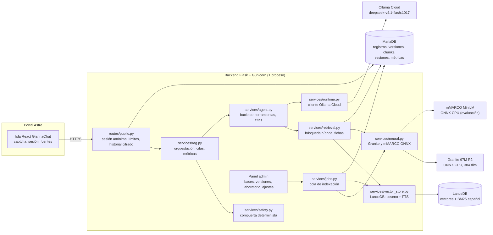
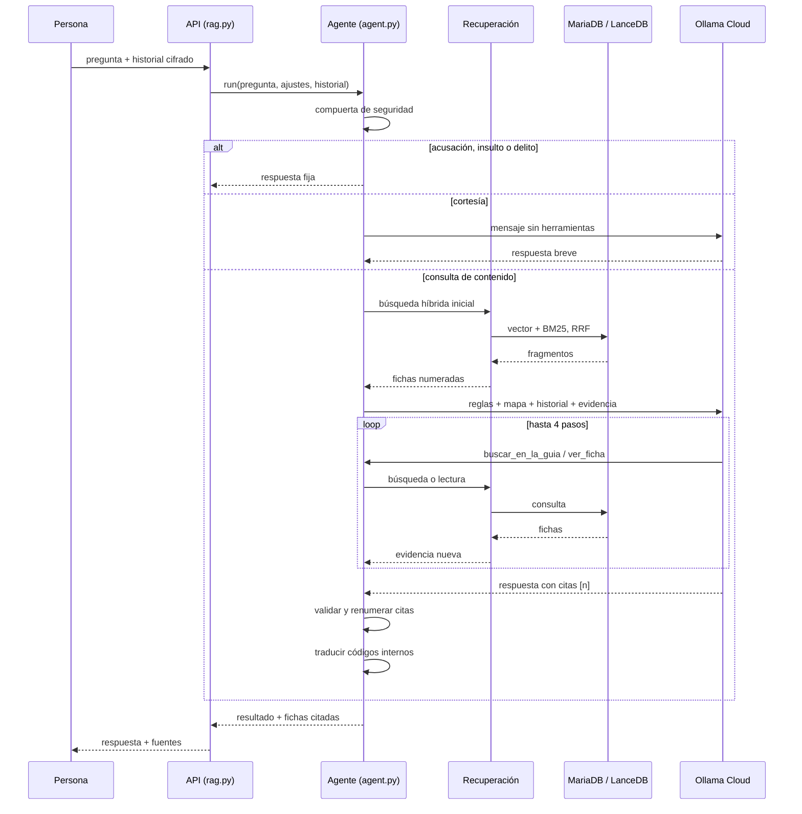
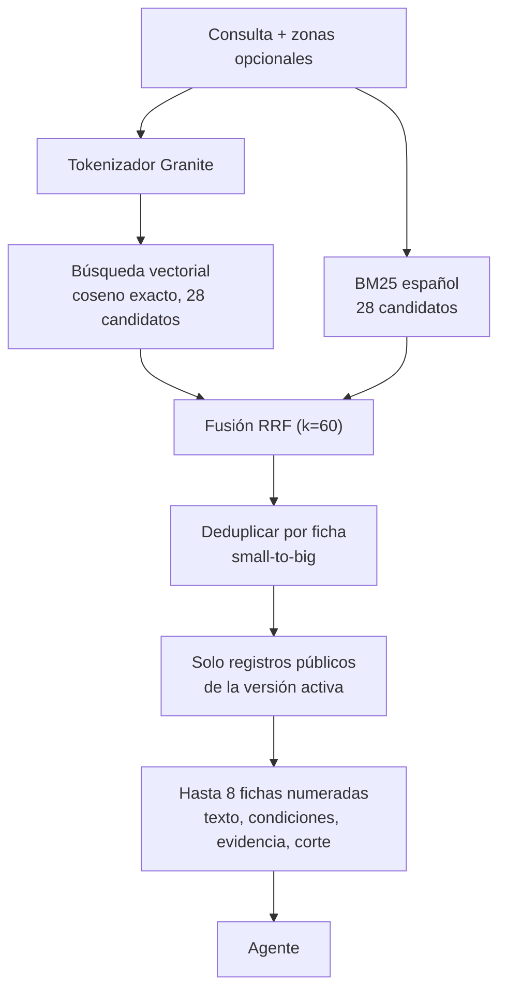

# Arquitectura RAG y del agente

**Candidata rc4:** el flujo de seguridad previo al RAG se describe en
[Seguridad de consultas](SEGURIDAD_CONSULTAS.md). Sustituye las aclaraciones
automáticas por términos de menores/locales descritas en versiones anteriores.

**Estado verificado el 06/11/2026** contra el código de `main` y la versión activa de la base local (`ca5f61b7…`, 262 fragmentos, motor `granite-mmarco-lance-v3`, representación `cards-context-v5`).

Actualización de persistencia del 07/11/2026: [arranque, integridad y recuperación](RECUPERACION.md). `KnowledgeRecovery` prepara en el worker el perfil de la fotografía activa y valida su huella y colección antes de habilitar consultas. Restaurar el índice utiliza sus vectores y texto lexical originales, sin cambiar la semántica del agente ni publicar otra versión. Los resultados de calidad anteriores no se atribuyen a las nuevas pruebas de persistencia.

Este documento describe cómo funciona Gianna hoy. Reemplaza al diseño anterior (planificador determinista + catálogo de rubros + contrato JSON), archivado en [`historico/`](historico/RAG_ENGINE_planificador_determinista.md). Las referencias a E5, Qdrant, FastEmbed y OpenVINO pertenecen a etapas anteriores del proyecto y no describen el sistema actual.

## Resumen

Gianna es un **agente con herramientas** sobre una base de conocimiento versionada:

1. La guía se convierte en **fichas autosuficientes** con una cabecera contextual.
2. Cada ficha se fragmenta con el tokenizador real del encoder y se indexa en **LanceDB** por significado (vector) y por palabras (BM25 español).
3. Cada consulta hace una **búsqueda híbrida inicial** y el modelo recibe la evidencia numerada.
4. Si hace falta, el modelo **busca otra vez** o **lee fichas completas** (hasta 4 pasos).
5. El servidor **valida las citas** contra la evidencia de esa consulta y arma la respuesta con sus fuentes.

No hay planificador de reglas, catálogo de rubros ni contrato JSON intermedio. El modelo generativo no decide qué existe en la guía: lo descubre con el mapa y las herramientas.

## Modelos y espacio vectorial

### Perfil vigente (`granite-mmarco-lance-v3`)

| Rol | Modelo | Revisión fijada | Artefacto | Runtime | Detalle |
| --- | --- | --- | --- | --- | --- |
| **Embedding** | `ibm-granite/granite-embedding-97m-multilingual-r2` | `835ad14087e140460703cf0fae09f97d469d65c2` | `onnx/model_quint8_avx2.onnx` | ONNX Runtime CPU 1.31.0 | 384 dimensiones, pooling **CLS**, normalización L2, hasta 512 tokens, sin prefijos `query:`/`passage:` |
| **Reranker** | `cross-encoder/mmarco-mMiniLMv2-L12-H384-v1` | `1427fd652930e4ba29e8149678df786c240d8825` | `onnx/model_quint8_avx2.onnx` | ONNX Runtime CPU 1.31.0 | Cross-encoder de hasta 512 tokens, puntaje sigmoide; serving acotado a 160 tokens y seis candidatos; ventana compartida de hasta 400 ms |
| **Búsqueda léxica** | BM25 de LanceDB | índice FTS de la tabla | — | LanceDB 0.40.0 | Idioma español, `stem=true`, `ascii_folding=true`, sin palabras vacías |
| **Fusión** | Reciprocal Rank Fusion | — | — | En código (`vector_store.py`, `retrieval.py`) | `k = 60`; no se suman coseno y BM25 como si fueran la misma escala |
| **Generación** | `deepseek-v4.1-flash:1017` (por defecto en esta instalación) | catálogo de Ollama Cloud | API `/api/chat` | Ollama Cloud | `think: low`; alternativa `deepseek-v4.1-flash` |

Los identificadores, revisiones y hashes de los artefactos viven en `gianna/services/neural.py`. El worker o la herramienta `scripts/prepare_models.py` recuperan únicamente esos archivos, verifican su integridad y dejan un `manifest.json` por modelo. La aplicación bloquea consultas hasta verificar los artefactos y la colección correspondiente.

### Cómo se elige el modelo generativo

- El modelo se selecciona en **Ajustes** y se guarda en la tabla `settings`.
- `OLLAMA_MODEL` solo inicia instalaciones nuevas; no sobrescribe una elección hecha en el panel.
- `OLLAMA_FALLBACK_MODELS` define la alternativa si el modelo elegido falla (por defecto `deepseek-v4.1-flash`).
- `services/runtime.py` decide el parámetro `think` por familia: `low` para `deepseek-v4.1-flash:1017` y para los modelos no listados, `false` para `deepseek-v4.1-flash` sin revisión, y sin `think` para `minimax-m3.1-flash`.
- Los nombres válidos se consultan en `/api/tags`; el panel tiene un botón para cargar el catálogo real y evitar identificadores inventados.

### Perfil anterior (solo lectura)

Las versiones publicadas con `bekko-horizon-lance-v2` conservan su propio par de modelos y su representación `bekko-context-v2`:

| Rol | Modelo | Revisión | Pooling |
| --- | --- | --- | --- |
| Embedding | `hotchpotch/bekko-embedding-v1-a8m` | `c721113d59a1d91b447450324f51c4b3332c924a` | media enmascarada |
| Reranker | `Horizon-Labs/multilingual-reranker-small` | `c2ec8fb3e499725b168bbed2164bfee095360f77` | — |

No se mezclan vectores entre perfiles. Una versión antigua se puede consultar y restaurar, pero no se puede publicar una versión nueva con ese motor: hay que generar una versión con el perfil vigente. La huella (`fingerprint`) incluye modelo, revisión, pooling, normalización, runtime, dimensión, representación documental y hashes; si cambia, la versión deja de ser compatible.

## Flujo de una consulta

```text
pregunta
  │
  ├─ compuerta de seguridad determinista (safety.py)
  │     acusaciones, insultos o delitos graves → respuesta fija, sin modelo
  │
  ├─ cortesía pura ("hola", "gracias") → modelo sin herramientas ni citas
  │
  └─ consulta de contenido
        │
        ├─ búsqueda híbrida inicial (retrieval.py)
        │     vector Granite + BM25 español → RRF
        │     seguimiento corto ("¿y en Varela?") = pregunta anterior + actual
        │
        ├─ agente con herramientas (agent.py, hasta 4 pasos, 100 s)
        │     buscar_en_la_guia(consulta, zonas?, tipo?)
        │     ver_ficha(identificador | [n])
        │
        ├─ respuesta con citas [n]
        │
        └─ validación: citas inexistentes se descartan, se renumeran 1..n,
              códigos internos se traducen a nombres, se adjuntan fuentes
```

Si el proveedor falla después de los reintentos y del modelo alternativo, y ya hay evidencia, la respuesta pasa a estado `degraded` con las tres fichas más relacionadas. Sin evidencia, se devuelve un error `ollama_unavailable` claro. El prompt incluye el **mapa de la guía** (identificador y título de las fichas públicas, agrupadas por tema) para que el modelo sepa qué existe antes de afirmar que algo no está.

## Diagramas

### Componentes



### Indexación y publicación

```mermaid
flowchart LR
    DOCX["Documento fuente<br/>.docx"] --> CONV["Conversión<br/>gianna.corpus.v1"]
    CONV --> RESTR["restructure.py<br/>fichas autosuficientes"]
    RESTR --> IMP["Importación<br/>borrador en MariaDB"]
    IMP --> REV["Revisión y aprobación<br/>editorial"]
    REV --> BUILD["Construcción de versión<br/>inmutable"]
    BUILD --> CHUNK["Chunking<br/>420 tokens, 40 de solapamiento<br/>cabecera cards-context-v5"]
    CHUNK --> EMB["Embeddings Granite<br/>384 dim, CLS/L2"]
    EMB --> LANCE["Tabla LanceDB<br/>vector + FTS español"]
    LANCE --> CHECK["Verificación de conteo<br/>y huella"]
    CHECK --> LAB["Laboratorio y evaluación"]
    LAB --> PUBL["Publicación<br/>puntero transaccional"]
    PUBL --> CHAT["Chat público"]
    PUBL -.->|rollback| BUILD
```



### Una consulta, en detalle



### Recuperación híbrida (detalle)



El chat y el laboratorio pueden reordenar hasta seis candidatos, conservando el resto y los filtros, con un único presupuesto de hasta 400 ms por respuesta. La ventana comienza antes del encoder e incluye la espera causada por otras inferencias. La caché por versión evita repetir puntuaciones. Si falla, está ocupado o vence la ventana, se conserva exactamente el híbrido. Los modos offline explícitos se mantienen separados. Contrato y observabilidad: [Reranking acotado](RERANKING_ACOTADO.md).

## La base de conocimiento

- **Formato de entrada:** `gianna.corpus.v1` (JSON). Cada registro incluye `id`, `title`, `section`, `topic`, `audience` (`public`/`internal`), `evidence_type`, `text`, `conditions`, `source_refs`, `zones`, `opportunity_id`, fechas y trazabilidad al documento original.
- **Fichas autosuficientes:** `better-rag/tools/restructure.py` fusiona los registros contiguos de una tabla en su ficha padre. El consolidado se reorganiza en 332 fichas (257 públicas y 75 internas). La versión publicada indexa solo las 257 públicas, que producen 262 fragmentos; las internas nunca entran al índice. Evita recuperar "Ocupación supuesta: 70 %" o "2 · Contrastar mercado" sin su contexto.
- **Cabecera contextual** (`chunking.py`, `cards-context-v5`): título, tema, sección y zonas se anteponen al texto del embedding **y** del BM25. Se corta con el tokenizador real de Granite: 420 tokens por fragmento y 40 de solapamiento por defecto. La versión activa tiene 262 fragmentos para 257 fichas.
- **Small-to-big:** se recupera por fragmento y el agente recibe la ficha completa con sus condiciones, nivel de evidencia, fecha de corte y período.
- **Índice:** MariaDB guarda registros, versiones, fragmentos y caché de embeddings; LanceDB guarda los vectores y el índice FTS. Las versiones son inmutables y publicar es mover un puntero transaccional.
- **Trazabilidad:** cada cita adjunta título, extracto, nivel de evidencia, fecha de corte, localizador y fuentes primarias. El texto de la pregunta no se guarda en claro: solo su hash.

## Parámetros que cambian el comportamiento

| Parámetro | Valor por defecto | Dónde se ajusta |
| --- | --- | --- |
| Candidatos por canal | 28 | `retrieval_candidates` (Ajustes) |
| Fichas entregadas por búsqueda | 8 | `retrieval_limit` (Ajustes) |
| Fragmento / solapamiento | 420 / 40 tokens | `chunk_tokens`, `overlap_tokens` (Ajustes) |
| Pasos del agente | 4 | `MAX_STEPS` (`agent.py`) |
| Llamadas por paso | 6 | `agent.py` |
| Evidencia máxima | 36.000 caracteres | `agent.py` |
| Plazo total | 100 s | `agent.py` (Gunicorn corta a 120 s) |
| Historial | 14.000 caracteres | `context_budget.py` |
| Temperatura / salida | 0,2 / 4.096 tokens | Ajustes |

## Mediciones de recuperación

Conjunto de oro de 51 preguntas (`evals/retrieval_gold.json`), sin llamar al modelo. Los tres modos se midieron el 06/11/2026 sobre la versión activa:

| Modo | hit@1 | hit@3 | hit@5 | hit@8 | MRR | ms por búsqueda |
| --- | --- | --- | --- | --- | --- | --- |
| **Híbrido (camino de la consulta)** | 0,745 | 0,902 | 0,922 | **0,961** | 0,830 | **145** |
| Híbrido + cross-encoder (fusión) | 0,725 | 0,922 | 0,941 | 0,941 | 0,825 | 6.023 |
| Solo cross-encoder | 0,784 | 0,882 | 0,902 | 0,922 | 0,841 | 6.571 |

Esta comparación es histórica y corresponde al reranking completo, no al serving acotado incorporado en rc5. No acredita su latencia actual. Los nuevos ensayos del reranking de ventana limitada, caché, concurrencia y fallback se conservan en `reports/rerank/`; ver `reports/VALIDACION.md`.

Estas cifras miden cobertura de fichas, no exactitud factual. El conjunto lo escribió el mismo equipo que ajustó el sistema: no es un holdout ciego.

## Operación

```bash
# Opcional: preparar manualmente los modelos fijados (encoder + reranker)
python -m scripts.prepare_models --model-dir /app/data/models

# Verificar el runtime sin red
python -m scripts.check_model_runtime

# Importar, indexar y publicar un corpus
python scripts/ingest_corpus.py CORPUS.gianna.json --approve-technical --activate

# Medir recuperación (sin costo de proveedor)
python scripts/evaluate_retrieval.py --modes hybrid --verbose

# Evaluar conversaciones reales (consume cuota)
python scripts/evaluate_answers.py --report informe.md
```

El worker prepara automáticamente los modelos del perfil publicado o de la indexación solicitada, con verificaciones de integridad y reintentos acotados. Si faltan archivos, puede descargarlos desde las revisiones fijadas fuera de las solicitudes HTTP. `prepare_models` sigue disponible para mantenimiento y prueba ambos modelos; el reranker puede intervenir en las consultas mediante el presupuesto y fallback descritos en `RERANKING_ACOTADO.md`.

## Límites conocidos

- La respuesta la redacta un modelo no determinista: puede equivocarse aunque cite. Los controles automáticos detectan cifras ausentes de la evidencia, códigos internos, longitud y estados, pero no una afirmación errónea bien citada.
- La guía es la única fuente. No hay web, inventario de predios, precios ni contactos fuera de lo que figura en ella.
- Las hipótesis y los ejemplos numéricos se presentan como tales, no como datos observados.
- Las versiones publicadas con el motor anterior siguen consultables con su representación original; no se mezclan con el perfil vigente.
- La latencia de recuperación medida (145 ms de promedio) corresponde a este equipo. En el servidor destino hay que volver a medirla con la CPU real.
